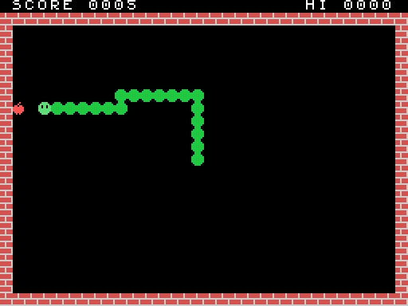

# Making an MSX game — a snake, step by step

This tutorial builds a complete game for the MSX1 in Z80 assembly. It's a snake game: you steer
with the cursor keys, eat apples, grow longer and speed up, and the game ends when you hit a wall
or yourself. The result is an ordinary 16 KB cartridge. It runs in `MSX.eeform` and also on a real
MSX or in openMSX.



It takes five steps. Each one is a complete program in [`docs/msx/snake/`](snake/) that you can
build and run:

| Step | File | What it adds |
|---|---|---|
| 1 | [`step1.asm`](snake/step1.asm) | A cartridge that boots and prints "Hello, MSX!" |
| 2 | [`step2.asm`](snake/step2.asm) | Our own tiles: bricks, the snake, an apple; the playing field and the score |
| 3 | [`step3.asm`](snake/step3.asm) | The snake moves, steers and crashes |
| 4 | [`step4.asm`](snake/step4.asm) | Apples: eating, growing, the score, speeding up |
| 5 | [`snake.asm`](snake/snake.asm) | Sound, a title screen, the best score, playing again |

## What you need

You need nothing besides this repository:

- **The assembler** is [`dev/z80asm.mjs`](../../dev/z80asm.mjs). It turns a `.asm` file into a `.rom`:

  ```
  npm run msx:asm -- docs/msx/snake/step1.asm          → docs/msx/snake/step1.rom
  npm run msx:asm -- docs/msx/snake/step1.asm -l       the same, and a listing: address, bytes, source
  ```

  It takes the usual Z80 source syntax, close to sjasmplus's, and has nothing to install.

- **The MSX** is `workspace/examples/MSX.eeform`. Open it, press **run**, then
  **Load cartridge…** and pick the `.rom`. Click the screen so it gets the keys.

So the loop is: **edit → `npm run msx:asm` → Load cartridge…**. After you rebuild, load the
new `.rom` again; **Reset** restarts the cartridge that's already loaded.

To write your own version, copy a step and change it, e.g. `cp docs/msx/snake/step3.asm mysnake.asm`.

## What an MSX is, in brief

It's a Z80 at 3.58 MHz with 64 KB of address space in four 16 KB pages:

| Address | What's there when our cartridge runs |
|---|---|
| `0x0000–0x3FFF` | The **BIOS** ROM: routines we can `CALL` (clear the screen, read the keys, make sound…) |
| `0x4000–0x7FFF` | **Our cartridge** |
| `0x8000–0xBFFF` | Nothing we'll use |
| `0xC000–0xFFFF` | **RAM**. The BIOS keeps its variables and the stack at the top (from `0xF380`); we use `0xE000–0xE20F` |

The picture comes from a separate chip, the **TMS9918A VDP**. It has 16 KB of video memory of its
own, which the Z80 can't see directly. To reach it, the Z80 sends an address to I/O port `0x99`,
then reads or writes bytes through port `0x98`. The address moves on by one after each byte.

The sound comes from a third chip, the **AY-3-8910 PSG**. It has three tone channels, a noise
generator and an envelope, all controlled by 14 registers.

---

## Step 1 — a cartridge that says hello

[`step1.asm`](snake/step1.asm)

### The header

When the MSX starts, the BIOS looks in each slot for the letters `AB`. If it finds them at
`0x4000`, it calls the address stored right after them:

```asm
         org 0x4000             ; the bytes that follow go at 0x4000
         db "AB"
         dw start               ; where our program starts
         ds 12                  ; the rest of the 16-byte header: unused
```

### Calling the BIOS

The BIOS has an entry point for each routine at a fixed address, the same on every MSX. We give
them names with `equ`:

```asm
CHGCLR   equ 0x0062     ; set the screen's colours from FORCLR, BAKCLR and BDRCLR
INIT32   equ 0x006F     ; SCREEN 1: 32×24 tiles of 8×8 pixels
FORCLR   equ 0xF3E9     ; the BIOS's colour variables, in RAM
```

```asm
start:   ld a,15                ; white letters
         ld (FORCLR),a
         ld a,4                 ; on dark blue
         ld (BAKCLR),a
         ld (BDRCLR),a
         call CHGCLR
         call INIT32            ; SCREEN 1, the font loaded, the screen cleared
```

The MSX has 16 colours, numbered 0–15: 1 black, 4 dark blue, 15 white, and so on. You can see all
16 in `TMS_PALETTE` in `src/display/tms9918.ts`.

### SCREEN 1

The whole game uses **SCREEN 1**, "Graphics I" in the chip's own terms. The screen is a grid of
32×24 cells, and each cell shows one of 256 tiles of 8×8 pixels. Three tables in video memory
make the picture:

| Table | Address | Size | What |
|---|---|---|---|
| Patterns | `0x0000` | 256 × 8 bytes | Each tile's pixels: a byte per row, a 1 bit is ink |
| Names | `0x1800` | 32 × 24 bytes | Which tile each cell shows, row by row |
| Colours | `0x2000` | 32 bytes | The colours of each group of 8 tiles: ink × 16 + paper |

`INIT32` loads the font into the patterns, so tile 65 is a letter `A`. To put a letter on the
screen, we write its code into the names table. The cell at column x, row y is at
`0x1800 + y*32 + x`.

### Writing to the video chip

```asm
setwrite:
         di
         ld a,l
         out (VDP_CTRL),a       ; the address's low byte…
         ld a,h
         or 0x40                ; …then the high byte, with 01 in the top bits: for writing
         out (VDP_CTRL),a
         ei
         ret
```

After this, each `out (VDP_DATA),a` writes a byte and moves the address on. `print` uses it to
write a string that ends in 0, starting at cell DE.

Why `di`/`ei`? Sixty times a second the video chip interrupts the Z80, and the BIOS's interrupt
handler reads the chip's status. That read resets the chip's "first or second byte?" latch. If
the interrupt came between our two bytes, the chip would take our second byte as a first one.
So the two `out`s go with interrupts off.

### Doing nothing, properly

```asm
forever: ei
         halt                   ; wait for the next frame, for ever
         jr forever
```

`halt` stops the Z80 until the next interrupt, which arrives at the start of every frame, 60 times
a second. A game's main loop is exactly this, with work between the `halt`s. It's how the game
keeps time.

Build it, load it, and the screen says hello.

---

## Step 2 — tiles of our own

[`step2.asm`](snake/step2.asm)

From this step on, the constants for the whole game are at the top of the file: every BIOS
routine, the video tables, and our variables in RAM.

### Drawing tiles

A tile is 8 bytes, one per row, with the leftmost pixel in the top bit. Here's the head:

```asm
         db 0b00111100          ;   ####
         db 0b01111110          ;  ######
         db 0b11011011          ; ## ## ##   the eyes are paper
         db 0b11011011
         db 0b11111111
         db 0b11111111
         db 0b01111110
         db 0b00111100
```

### Why the tiles are 0x80, 0x88, 0x90 and 0x98

In SCREEN 1, **colours belong to groups of eight tiles**. Tiles 0–7 share colour byte 0, tiles
8–15 share byte 1, and so on. To give each of our tiles its own colours, each goes at the start
of its own group:

```asm
EMPTY    equ ' '            ; the font's space
WALL     equ 0x80           ; group 16
BODY     equ 0x88           ; group 17
HEAD     equ 0x90           ; group 18
APPLE    equ 0x98           ; group 19

colours: db 0x6E            ; wall: ink 6 (dark red), paper 14 (grey)
         db 0x21            ; body: green on black
         db 0x31            ; head: light green
         db 0x81            ; apple: red
```

Tiles 0x80–0x9F are font characters we don't need, so we draw over them. `LDIRVM` is the BIOS's
"copy memory to video memory": it copies BC bytes from HL to DE. One call per tile puts the
pixels in (that's the `.tile` loop), and one call puts the four colours at `0x2000 + 0x80/8`.

### The field

`field` fills the screen with spaces (`FILVRM`), then draws the walls: two full rows with
`FILVRM` and the two sides cell by cell with `put`. `put` puts tile A on cell HL. Then it writes
`SCORE` and `HI`.

### Numbers on the screen: BCD

The score is kept in **BCD**, binary-coded decimal: each 4 bits hold one decimal digit, so the
score 1234 is the two bytes `0x34 0x12`. That makes printing easy, because each nibble plus `'0'`
is a digit, with no division needed (`bcd`). Adding to a BCD number is easy too, as step 4 shows.

A label that starts with `.`, like `.two` in `bcd` or `.side` in `field`, is **local**: it
belongs to the label above it, so every routine can have its own `.loop` without a clash.

---

## Step 3 — the snake moves

[`step3.asm`](snake/step3.asm)

### Where the snake is: a ring

The snake is a list of cells, from its tail to its head. Each step, a new cell goes on at the
head and one comes off at the tail. A **ring buffer** does this without moving anything: 256
entries of 2 bytes at `RING`, and two one-byte indexes. `HEADI` is the head's entry and `TAILI`
the tail's. Moving means `inc` on each index, and because they're bytes, 255 wraps round to 0 by
itself. `ringat` turns an index into the entry's address.

A cell is a number from 0 to 767 (`y*32 + x`). That makes moving a single addition: +1 is right,
−1 left, +32 down, −32 up. `DIR` holds the one we're going in.

### Time

The main loop runs once per frame. The snake moves only once every `SPEED` frames, counted down in
`TIMER`. With 8 frames per step that's 7.5 cells a second:

```asm
play:    ei
         halt                   ; the next frame
         call steer             ; read the keys every frame…
         ld hl,TIMER
         dec (hl)
         jr nz,play             ; …but move only when the timer runs out
         ld a,(SPEED)
         ld (TIMER),a
         call step
         jr nc,play             ; no carry: still alive
```

### Steering

`GTSTCK` with A=0 reads the cursor keys as a direction: 1 up, 3 right, 5 down, 7 left (and the
diagonals in between). `steer` turns that into a step and keeps it in `WANT`. It doesn't go into
`DIR` straight away: `step` takes it only if it isn't the exact opposite of `DIR`, which would
send the snake into its own neck. A direction plus its opposite is 0, so that's the test:

```asm
step:    ld hl,(WANT)
         ld de,(DIR)
         add hl,de              ; a direction and its opposite add up to 0
         ld a,h
         or l
         jr z,.ahead            ; straight back: ignore it
```

### Moving, and crashing

Each step:

1. The head's cell becomes `BODY`.
2. The next cell is the head's cell + `DIR`.
3. `get` reads the tile on that cell from the names table (`setread`, then `in a,(VDP_DATA)`).
   The screen is our map: if the cell isn't `EMPTY`, we've hit a wall or ourselves. We return
   with the carry flag set.
4. Otherwise `HEAD` goes on the new cell, and the cell is added at `HEADI`.
5. The tail's cell becomes `EMPTY`, and `TAILI` moves on.

When `step` returns with the carry set, the main loop prints `GAME OVER` and stops.

---

## Step 4 — apples

[`step4.asm`](snake/step4.asm)

### Random numbers

The Z80 has no random-number instruction. `random` is a 16-bit **xorshift**: a few shifts and
XORs that walk through all 65,535 non-zero values in a scrambled order. In this step `SEED` always
starts at 1, so every game has the same apples. Step 5 fixes that.

### Putting an apple down

`apple` picks a random cell and keeps trying until the cell is empty and on the field:

```asm
apple:   call random
         ld a,h
         and 3
         ld h,a                 ; 0–1023
         cp 3
         jr z,apple             ; 768 and over: off the screen
         …                      ; rows 0 and 1 (the score, the top wall): try again
.on      call get
         cp EMPTY
         jr nz,apple            ; something's there: try again
         ld a,APPLE
         jp put
```

### Eating

In `step`, if the next cell holds `APPLE`, we call `eat` before moving on:

- **A point**, added in BCD. `daa` ("decimal adjust") fixes the digits after a binary add, and the
  carry takes a 1 from the units and tens into the hundreds:

  ```asm
         ld a,(SCORE)
         add a,1
         daa                    ; 0x09 + 1 = 0x0A → 0x10
         ld (SCORE),a
         ld a,(SCORE+1)
         adc a,0                ; the carry
         daa
         ld (SCORE+1),a
  ```

- **Three cells longer.** `GROW` counts steps on which the tail stays put. The check on the length
  keeps the snake under 240 cells, so the 256-entry ring never fills.
- **Faster**: every fourth apple takes one frame off `SPEED`, down to 3, which is 20 cells a
  second.
- **A new apple.**

---

## Step 5 — sound, a title, the best score, again

[`snake.asm`](snake/snake.asm)

### Sound

The PSG is set through its registers: `WRTPSG` writes E into register A. `psg` writes a list of
register and value pairs that ends with `0xFF`, so each sound is a line of data:

```asm
quiet:   db 7,0b10011110, 8,0, 9,0, 10,0, 0xFF
chomp:   db 0,80, 1,0, 8,16, 10,0, 11,0, 12,4, 13,0, 0xFF
crash:   db 6,31, 8,0, 10,16, 11,0, 12,40, 13,0, 0xFF
```

| Register | What it does |
|---|---|
| 0–1 | Channel A's pitch: the chip's 1,789,772 Hz ÷ 16 ÷ this. 80 gives about 1,400 Hz, a "blip" |
| 6 | The noise's pitch: 31 is the lowest, a rumble |
| 7 | The mixer. A **0** bit turns something on: bits 0–2 tone A/B/C, bits 3–5 noise A/B/C. Bits 6–7 must be `10` on an MSX |
| 8–10 | Volumes of A, B, C: 0–15, or **16 to follow the envelope** |
| 11–12 | The envelope's length |
| 13 | The envelope's shape. 0 fades out once; **writing it restarts the envelope** |

The envelope makes each sound fade out by itself. The game starts a sound and never has to stop
it, so there's no sound code in the main loop. The eating blip is channel A's tone with a short
envelope. The crash is noise on channel C with a long one.

### The title, and random apples at last

Before the first game, the program draws the field with the title over it and calls `waitspace`.
`waitspace` waits for Space to be let go, then pressed (`GTTRIG` with A=0 is the space bar). It
calls `frame` once per frame, and `frame` also adds 1 to `SEED`. How long the player takes to
press Space decides where the apples fall, so no two games are the same.

### The best score

BCD numbers compare just like ordinary ones, so finding a new best is a 16-bit subtraction:

```asm
         ld hl,(HISCORE)
         ld de,(SCORE)
         or a                   ; clear the carry…
         sbc hl,de              ; …HISCORE − SCORE: a carry means SCORE is higher
         jr nc,.over
         ld (HISCORE),de
```

Then `GAME OVER`, `waitspace`, and `jp newgame`. The game goes on as long as you want to play.

---

## Where next

Some ideas, roughly from easy to harder:

- **Levels.** Draw some walls inside the field in `field` after a number of apples.
  `get` sees them without any other change.
- **A pause.** Check another key with `SNSMAT` (`0x0141`, A = keyboard row, returns its bits,
  with a 0 bit for a key held). P is row 4, bit 5.
- **A smoother head.** Draw the head as a **sprite**: sprite patterns at `0x3800`, position and
  colour at `0x1B00` (y, x, pattern, colour, with y = 208 ending the list). Move it a pixel at a
  time between steps. The demo cartridge in `MSX.eeform` moves a sprite; its listing is in the form.
- **Two players.** A second snake with its own ring, steered with WASD through `SNSMAT`.
- **Music.** Channels B and C are free: a tune is a table of pitches, and the frame loop changes
  the note every few frames.

## When something goes wrong

- **A BIOS call changed my registers.** Most BIOS routines change AF, BC, DE and HL. Keep what you
  need with `push`/`pop` around the call, as `psg` does around `WRTPSG`.
- **"the jump is … out of reach".** `JR` and `DJNZ` reach only 127 bytes either way. Use `JP`.
- **The screen is garbled.** The two bytes to `VDP_CTRL` were split by the interrupt (keep them in
  `di`/`ei`), or a tile went past the screen (cell over 767).
- **Nothing happens at all.** Check the header: `"AB"` at `0x4000` and the `dw start` after it.
  Build with `-l` and look at the listing.
- **The program freezes.** Look for a `halt` with interrupts off. `ei` before each `halt`.
- **The `.rom` is too big.** The final `ds 0x8000 - $` says "the code before it is too long" if
  the program grows past 16 KB. Without a mapper a cartridge can be 32 KB: `ds 0xC000 - $`
  (`docs/msx/MSX.md`).

## Reference

### The BIOS calls used here

| Name | Address | In | Out |
|---|---|---|---|
| `CHGCLR` | `0x0062` | `FORCLR`, `BAKCLR`, `BDRCLR` (`0xF3E9–B`) | The colours set |
| `INIT32` | `0x006F` | | SCREEN 1, cleared, the font loaded |
| `FILVRM` | `0x0056` | HL video address, BC count, A byte | |
| `LDIRVM` | `0x005C` | HL memory, DE video address, BC count | |
| `WRTPSG` | `0x0093` | A register, E value | |
| `GTSTCK` | `0x00D5` | A = 0 (cursor keys) | A = 0–8: 0 none, 1 up, then clockwise |
| `GTTRIG` | `0x00D8` | A = 0 (space bar) | A = `0xFF` held, 0 not |
| `SNSMAT` | `0x0141` | A = keyboard row | A = its keys, a 0 bit is held |

### The assembler

```asm
SIZE    equ 32*24               ; a constant
label:  ld a,(hl)               ; a label starts in column 1; the colon is optional
.loop   djnz .loop              ; a local label, belonging to the label above
        org 0x4000              ; where the following bytes go
        db 1, "text", 'c', 0x1F, $1F, 1Fh, 0b101, %101
        dw label                ; a word, low byte first
        ds 16, 0xFF             ; 16 bytes of 0xFF
        ld a,HIGH(label)        ; and LOW()
```

Expressions can use `+ - * / % & | ^ << >> ~`, parentheses, and `$` for the current address. The
assembler knows all the documented Z80 instructions, IX and IY included. The source file says
the rest: [`dev/z80asm.mjs`](../../dev/z80asm.mjs).
